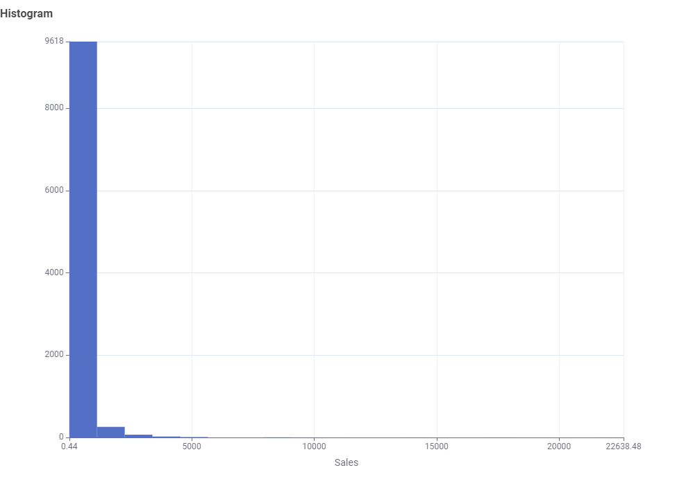

# Superstore Profit Prediction

Predicting loss-making retail orders with KNIME, and exploring sales, profit and discounts with a Power BI dashboard.

## Dataset

[Sample Superstore](https://www.kaggle.com/datasets/bravehart101/sample-supermarket-dataset) from Kaggle: 9,994 orders from a fictional US retail store, originally published by Tableau as practice data.

The 13 columns are Ship Mode, Segment, Country, City, State, Postal Code, Region, Category, Sub-Category, Sales, Quantity, Discount and Profit.

## The question

**Can we predict whether an order will make a profit or a loss, before knowing its sales and profit values?**

About 81% of orders are profitable, so a model that always guesses "Profitable" is already 81% accurate. A useful model has to beat that baseline and catch the loss-making orders.

## Project history

**Version 1**

- Predicted whether each order's sales were High (500 or more), Medium (200 to 499) or Low (under 200).
- Trained a Decision Tree and a Random Forest in KNIME. Both scored 100% accuracy.

**What I found**

The 100% accuracy was too good to be true. The target (High, Medium or Low) was created directly from the Sales column, and Sales was also given to the models as an input, so they could read the answer. This is **target leakage**. Profit was also included as an input, and it is closely tied to Sales.

**Version 2**

- Changed the question to predicting whether an order is **profitable or loss-making**.
- Removed the leaking columns (Sales and Profit) from the model inputs.
- Compared 4 models against the baseline, using F1-score on loss orders as well as accuracy, because losses are the smaller class.

The original workflow is kept in `knime/v1-original/` for reference.

## KNIME workflow 

1. **Excel Reader** loads the data.
2. **Column Filter** removes Country and Postal Code.
3. **Missing Value** fills missing numbers with the median.
4. **Rule Engine** creates the target column `Order Result`: "Profitable" if Profit > 0, otherwise "Loss".
5. **One to Many** one-hot encodes Ship Mode, Segment, Region, Category and Sub-Category.
6. **Column Filter** removes the model inputs that would leak the answer or add noise: Sales, Profit, City, State and the original text columns.
7. **Table Partitioner** splits the data 70/30 for training and testing, stratified by `Order Result`.
8. **Four models**, each with a learner, predictor and scorer: Decision Tree, Random Forest, Logistic Regression and Gradient Boosted Trees.

## Results

Test set: 2,999 orders (30%).

| Model | Accuracy | F1 (Loss) |
|---|---|---|
| Baseline (always "Profitable") | ~81% | 0 |
| Decision Tree | 92.69% | 0.805 |
| Random Forest | 93.60% | 0.812 |
| Logistic Regression | 94.30% | 0.84 |
| **Gradient Boosted Trees** | **95.39%** | **0.87** |

- **Gradient Boosted Trees performed best,** catching the most loss-making orders.
- **Logistic Regression came close with a much simpler model,** which suggests that one factor explains most of the losses.
- **Discount is that factor.** It is the first split in the Decision Tree.

## Key findings

| Discount level | Orders | Profit margin |
|---|---|---|
| No discount | 4,798 | 29.5% |
| 1–20% | 3,803 | 11.9% |
| Above 20% | 1,393 | **−37.3%** |

- **Discounts above 20% turn orders unprofitable,** losing about $135,000 in total.
- **Furniture earns only a 2.5% margin,** compared with about 17% for Technology and Office Supplies.
- **Tables, Bookcases and Supplies lose money overall.**
- **The Central region has the lowest margin** (7.9%).

## Power BI dashboard

`power-bi/superstore-dashboard.pbix` has 3 pages:

1. **Sales & Profit Overview:** KPI cards (total sales, total profit, average discount) and sales by region, segment and state, with filters.
2. **Product & Segment Analysis:** sales by category and sub-category, and profit by category and segment.
3. **Price, Profit & Discount Insights:** sales against profit by discount impact, average discount by sub-category and profit margin by category.

It also includes a custom tooltip page with product details.

## Charts

| | |
|---|---|
|  |  |
|  |  |

## Project structure

```
superstore-profit-prediction/
├── data/                  SampleSuperstore.csv and .xlsx
├── knime/
│   ├── Superstore_KNIME.knwf       Version 2 workflow
│   └── v1-original/                Version 1 workflow
├── outputs/               Charts and model results
├── power-bi/              Power BI dashboard (.pbix)
└── README.md
```

## How to open it

- **KNIME:** in KNIME 5.x, import `knime/Superstore_KNIME.knwf`. The Excel Reader and Excel Writer nodes use full file paths, so update them to where you saved the `data` and `outputs` folders.
- **Power BI:** open `power-bi/superstore-dashboard.pbix` in Power BI Desktop.

## Tools

KNIME Analytics Platform 5.9 and Power BI Desktop.
